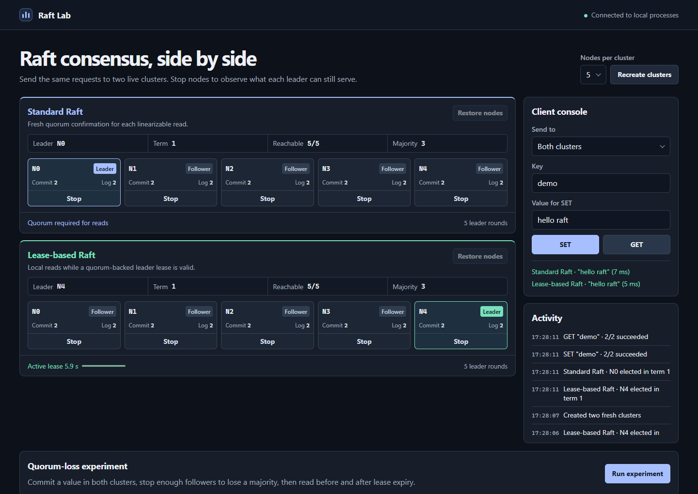

# Raft key-value store

Five independent Python processes replicate a string-to-string key-value store over gRPC. The `standard` and `lease` modes use the same election, log replication, persistence, and client code. They differ in how the leader proves it can serve a linearizable read.

| Mode | `GET` | After losing a quorum |
| --- | --- | --- |
| `standard` | Starts a fresh `AppendEntries` round and waits for a majority. | Reads and writes cannot complete successfully. |
| `lease` | Reads locally from the applied state while a quorum-confirmed lease is valid. | Reads can succeed until expiry. Writes still require a majority. The leader steps down at expiry. |

Both modes wait for the leader’s current-term `NO-OP` to be committed and applied before serving client operations. A successful `SET` means the log entry was stored by a majority and applied by the leader. A missing key returns an empty string. The client reuses a request ID across retries of each `SET`, so replaying the same operation cannot overwrite a later value.

## Measured tradeoffs

The benchmark runs five independent gRPC node processes per mode on one Windows 11 host (Ryzen 5 7530U, Python 3.14.3).

### Steady-state reads

| Configured extra peer RTT | Standard GET p50 / p95 | Lease GET p50 / p95 | Read-confirmation RPC attempts per GET, standard / lease |
| --- | ---: | ---: | ---: |
| 0 ms | 2.67 / 3.43 ms | 0.73 / 0.90 ms | 4 / 0 |
| 20 ms | 31.82 / 32.71 ms | 0.66 / 0.85 ms | 4 / 0 |
| 80 ms | 95.43 / **96.27 ms** | 0.67 / **0.80 ms** | 4 / 0 |

Each row uses 120 sequential reads per mode after 20 warmups. A client sends `GET` directly to the leader over one reused gRPC connection. The benchmark adds half the configured delay on either side of each peer RPC. Host scheduling can increase the realized delay. The counter records `AppendEntries` attempts in rounds confirming reads. In this implementation, standard mode fans out to all four peers and waits for the round to finish. Lease mode continues to renew through background replication.

### Leader crash recovery

| Lease setting | Crash to first successful GET, standard | Crash to first successful GET, lease | Observed election to successful GET, standard / lease |
| --- | ---: | ---: | ---: |
| 2 s (`default`) | 3.98 s (3.43–4.07 s) | 3.50 s (3.00–3.96 s) | 0.491 s / 0.002 s |
| 6 s (`lab`) | 4.14 s (3.82–4.71 s) | 6.05 s (5.79–6.81 s) | 0.506 s / **2.542 s** |

The table shows medians from five fresh clusters per mode and setting, with min–max ranges for crash-to-read time. Both modes use 500 ms heartbeats and randomized 3–5 s election timeouts. The benchmark kills the leader once a write has reached all nodes, then probes for a successor about every 50 ms and requests the same value. Election-to-read timing starts at the **first observed** successor, so it can miss a short wait between probes. Crash trials run with no added delay. The 2-second lease expired before the replacement needed to serve in this run. The longer lease can still be active after election, extending the time until a successor can serve.

Reproduce the run from the project root. The command emits JSON with the sample counts, percentiles, and crash timings.

```powershell
.\.venv\Scripts\python.exe -m raftkv.benchmark --reads 120 --rtt-ms 0 20 80 --failover-trials 5
```

On Google Cloud, five replicas across three zones completed **360,000 scheduled operations**. With 10% writes, a leader lease reduced GET p95 from **39.83 ms to 7.75 ms (80.5%)**, while SET p95 stayed near 52 ms in both modes. At 400 reads/s, Cloud Monitoring measured **74.5% fewer bytes sent per minute** by the lease leader. [Sustained benchmark and telemetry](docs/gcp-followup.md)

The earlier cloud run also measured recovery after a leader process crash and read availability after quorum loss. [Cloud failure and recovery results](docs/gcp-benchmark.md#failure-and-recovery)

## Visual lab

Start the lab after installing the dependencies. It launches two independent five-node clusters and serves the dashboard on loopback. Choose 3, 5, 7, or 9 nodes per cluster in the browser. Each node is a real Python process communicating over gRPC.

```powershell
.\.venv\Scripts\python.exe -m raftkv.lab
```

Open [Raft Lab](http://127.0.0.1:8000). Try a `SET` and `GET` in both clusters, stop a leader to see the election and handoff, and restart it to watch the commit and log positions catch up. **Run experiment** commits the same value to both clusters, removes their quorums by stopping followers, and records actual reads before and after lease expiry. **Restore nodes** restarts stopped processes with their existing logs. Recreating clusters starts a fresh lab run. The lab’s temporary data is cleared when it shuts down normally.



The lab uses a **6-second lease** to make the handoff and quorum-loss window visible. The normal CLI retains the documented 2-second default. The experiment targets the original leaders directly to isolate the effect of quorum loss. Client console request times include local client routing and retry deadlines. Use the regression tests for a controlled comparison of which operations require peer acknowledgments.

## Prerequisites

- Python 3.11 or newer with `venv` and `pip`. Verified with Python 3.14 on Windows.
- Git for version control. GitHub CLI and an authenticated GitHub account are needed only for publishing via `gh`.
- Five available loopback TCP ports. `cluster.local.json` uses `50051` through `50055`.
- `grpcio` and `protobuf` are installed from `requirements.txt`. Development dependencies add the protobuf compiler and pytest. The SQLite storage engine comes with Python.

From the repository root in PowerShell, create the environment and install the dependencies.

```powershell
py -m venv .venv
.\.venv\Scripts\python.exe -m pip install -r requirements-dev.txt
.\.venv\Scripts\python.exe -m pytest -q
```

On Linux, use `python3 -m venv .venv` and `.venv/bin/python` for the equivalent commands. The generated bindings are checked in. After editing `raftkv/raft.proto`, regenerate them with the environment’s Python.

```powershell
.\.venv\Scripts\python.exe -m grpc_tools.protoc -I. --python_out=. --grpc_python_out=. raftkv/raft.proto
```

## Run five nodes locally

Open five terminals in the repository root and run the following command in each, using a different `--id` from `0` through `4`.

```powershell
.\.venv\Scripts\python.exe -m raftkv node --id 0 --mode lease --data-root runs/lease
```

From a sixth terminal, run the client.

```powershell
.\.venv\Scripts\python.exe -m raftkv set x "hello Raft"
.\.venv\Scripts\python.exe -m raftkv get x
```

For standard Raft, stop the first cluster and launch all five nodes with `--mode standard --data-root runs/standard`. Keep the same mode, membership, and timing profile on every node. Restart a node with its original ID and data root to recover its durable log. A timed-out `SET` can already have been committed.

| Profile | Heartbeat | Election timeout | Lease duration |
| --- | --- | --- | --- |
| `default` | 500 ms | Randomized from 3 to 5 s | 2 s |
| `assignment` | 1 s | Randomized from 5 to 10 s | 4 s |
| `lab` | 500 ms | Randomized from 3 to 5 s | 6 s |

The default uses YugabyteDB’s documented heartbeat and lease defaults. The lower end of our election window comes from six missed 500 ms heartbeats, and we randomize over a wider window for this project. Use `--profile assignment` on all nodes for the slower classroom demo. [YugabyteDB tablet-server flags](https://docs.yugabyte.com/stable/reference/configuration/all-flags-yb-tserver/)

## Verify failover

Look for `became the leader` in each node’s `dump.txt`. The authoritative state is in each node’s SQLite database. `logs.txt` and `metadata.txt` are inspectable exports of the log and metadata, respectively. The dump records elections, replication, commits, and lease changes.

1. Stop two followers, write a value, then restart them. Their logs and applied values should catch up.
2. Stop the leader, then issue a `GET` and a `SET`. The client should discover the successor. Restart the former leader and check that it catches up as a follower.
3. In lease mode, stop three followers together. A prompt `GET` can succeed until the last lease expires. Watch for `lease renewal failed` in the leader’s dump. A `GET` or `SET` with `--timeout 2` then exits with an error. In standard mode the same `GET` requires a quorum immediately.

## Regression tests and tradeoffs

Run `python -m pytest -q` from the activated virtual environment. GitHub Actions runs the same suite on Windows and Linux.

| Scenario | Standard Raft | Lease-based Raft |
| --- | --- | --- |
| Peer acknowledgments withheld after a healthy write | `GET` stays pending even after one follower acknowledges. The test releases enough peers to finish the read. | `GET` returns the committed value while the peers are still blocked. |
| Healthy leader loses its quorum | `GET` requires a fresh quorum. A new `SET` cannot commit. | `GET` can return the committed value until expiry. A new `SET` still cannot commit. |
| A successor wins an election | It can serve after committing a current-term `NO-OP`. Its reads still require quorum confirmation. | The successor refuses both reads and writes while an old lease may still be valid, then needs its own quorum-backed lease. |
| Clock assumptions | Read safety comes from exchanging messages with a quorum. | Local reads depend on bounded monotonic clock drift and an advancing clock. |

The peer-gating regression exercises five- and seven-node clusters over loopback gRPC. Other tests cover conflicting uncommitted entries, vote persistence, follower restart, missing keys, write retries, and log catch-up. The lab regression drives both modes through quorum loss using independent operating-system processes.

## How the lease works

Each positive `AppendEntries` lease offer carries a duration. The leader records the local send time plus that duration for each peer. Its lease expiry is the latest deadline acknowledged by at least a majority, counting itself. Late acknowledgments cannot revive an expired leader. Followers record a conservative wait based on the local receipt time and return their longest known remaining wait in granted votes. A newly elected leader waits out those reports and its own record before it can offer a new lease. On restart, a node conservatively reports a full lease window to cover any prior grant it might have forgotten. [YugabyteDB’s Raft lease design](https://docs.yugabyte.com/stable/architecture/transactions/single-row-transactions/#leader-leases)

This design sends durations and uses monotonic clocks. Its safety assumes monotonic clocks advance continuously, including through VM pauses, and each node’s rate stays within 500 ppm of real time. Standard mode does not rely on a clock-rate bound for read safety. [Raft paper, §8](https://raft.github.io/raft.pdf)

## Run on five VMs

Copy `cluster.local.json` and replace each address with the corresponding VM’s reachable private address. Install Python and the runtime dependencies on each VM. Give each node the same cluster file, mode, and profile. Restrict the gRPC port to cluster peers and the client on the private network. The demo uses insecure gRPC and assumes trusted peers.

```bash
.venv/bin/python -m raftkv --cluster cluster.vm.json node --id 0 --mode lease --listen 0.0.0.0:50051 --data-root runs/lease
.venv/bin/python -m raftkv --cluster cluster.vm.json get x
```

### Benchmark from a separate VM

Run the remote benchmark from a host with access to the cluster's private gRPC addresses. Compare modes on the same infrastructure with the same offered rate, request mix, and run duration. The JSON report includes p50/p95/p99 for successful operations, counts of rejected and timed-out calls, achieved throughput, and read-confirmation peer RPC attempts. It reports client-side concurrency saturation separately.

Pass `--minute-histograms` to `load` to include per-minute outcomes and latency distributions for alignment with VM telemetry.

```bash
python -m raftkv.remote_benchmark --cluster cluster.vm.json load --rps 100 --seconds 30 --write-percent 10
python -m raftkv.remote_benchmark --cluster cluster.vm.json watch-failover
```

For the failover trial, wait for the watcher to print the original leader ID, then terminate its Raft process. The watcher measures from the first failed probe and the first observed successor election to a successful read. It also verifies ten values acknowledged before the crash.

For private Ubuntu 24.04 x86-64 VMs, build an offline bundle from the repository root. Copy the archive to each VM over SSH and extract it under `/opt/raft-benchmark`. The bundle includes the compatible Linux wheels.

```bash
python -m cloud.package --cluster cluster.vm.json --output raft-benchmark.tgz
```

On each replica, run `sudo bash /opt/raft-benchmark/cloud/bootstrap.sh node 0 standard default` with that VM's node ID. On the load generator, run `sudo bash /opt/raft-benchmark/cloud/bootstrap.sh driver`, then run the benchmark from `/opt/raft-benchmark` using `PYTHONPATH=vendor python3` and `--cluster cluster.json`. The replica service preserves its on-disk state within each mode and profile and can be restarted with `sudo systemctl start raft-benchmark.service` after a test crash.
