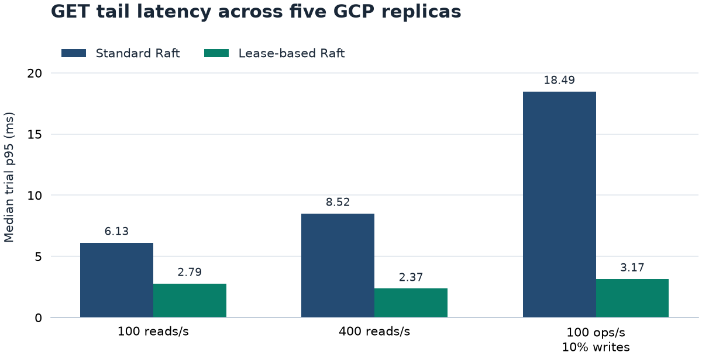
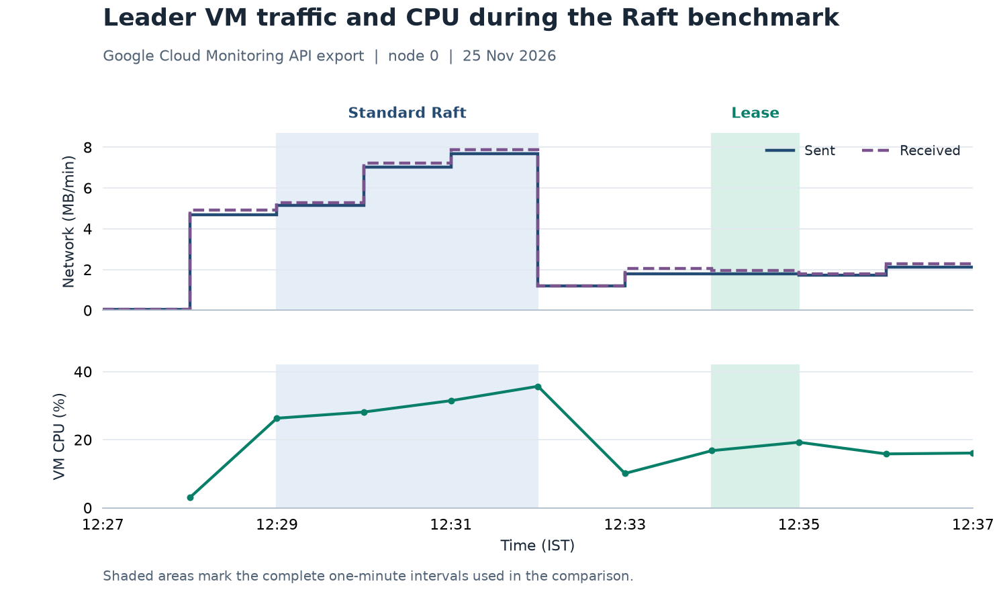
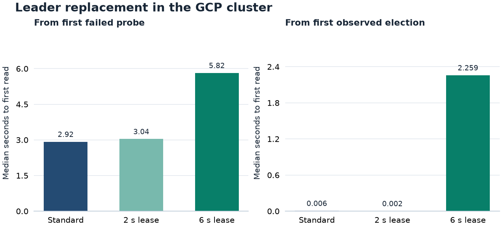

# Raft on Google Cloud

## Setup

The run used five Compute Engine replicas and a dedicated load generator in Iowa (`us-central1`). All six machines were `e2-standard-2` VMs running Ubuntu 24.04 x86-64. Two replicas and the load generator ran in zone `a`, two replicas ran in zone `b`, and one replica ran in zone `c`. Both steady-state runs began with node `0` in zone `a` as leader. All gRPC traffic used private VPC addresses.

| Setting | Value |
| --- | --- |
| Source | [`c82d033`](https://github.com/Samyzx/raft-consensus/tree/c82d033) |
| Heartbeat interval | 500 ms |
| Randomized election timeout | 3–5 s |
| Lease in steady-state comparison | 2 s |
| Added peer RTT | 0 ms |
| Workloads | 100 reads/s, 400 reads/s, and 100 operations/s with 10% writes |
| Sampling | Two matched trials per mode and workload, each with 5 s warmup and 20 s measurement |

The driver scheduled requests at a fixed offered rate and tracked rejections, timeouts, and client-side saturation separately. It compared successful `GET`s against a known committed value. The standard suite completed a third round, which the raw results retain. The connection dropped during the lease suite, so the comparison uses the two completed rounds from each mode.

### How latency was measured

The load generator started `time.perf_counter_ns()` immediately before issuing each gRPC call to the leader and stopped it when the call returned. The result is client-observed round-trip latency, including network travel, server processing, and any wait for quorum acknowledgments. Timing begins after the workload scheduler admits the request. Each trial calculates p95 and p99 by nearest rank over successful calls after warmup. The report takes the median of the two per-trial percentiles for each mode and workload. The ICMP RTT figures come from separate peer-to-peer pings. [Benchmark implementation](../raftkv/remote_benchmark.py)

## Steady-state results

Measured peer ICMP RTT was **0.40 ms within a zone** and **1.01 ms across zones**, using the median link average from eight pings per directed peer pair.

| Offered workload | Standard GET p95 / p99 | Lease GET p95 / p99 | Read-confirmation RPC attempts per successful GET, standard / lease |
| --- | ---: | ---: | ---: |
| 100 GET/s | 6.13 / 6.56 ms | 2.79 / 3.05 ms | 4.00 / 0 |
| 400 GET/s | 8.52 / 9.85 ms | 2.37 / 2.97 ms | 3.20 / 0 |
| 100 ops/s, 10% writes | 18.49 / 20.94 ms | 3.17 / 3.98 ms | 3.96 / 0 |

All **48,000 operations** in the matched trials succeeded. In the mixed workload, `SET` p95 was **21.84 ms** in standard mode and **22.48 ms** in lease mode. Reads can use a valid lease while writes still wait for a quorum. At 400 reads/s, standard mode can share a confirmation round between overlapping reads, reducing its peer RPC attempts per read.



## Cloud Monitoring evidence

Historical Compute Engine samples were retrieved with the [Cloud Monitoring time-series API](https://docs.cloud.google.com/monitoring/api/ref_v3/rest/v3/projects.timeSeries/list) for all six original workload VMs after deletion. The [CSV export](gcp-vm-telemetry.csv) contains 300 samples with anonymized node names, UTC timestamps, and original values. The metrics cover CPU utilization, vCPU scheduler wait, network bytes sent and received, and disk write operations.

On November 25, 2026, the original leader's complete standard-mode minutes fell between **12:29 and 12:32 IST**. The complete lease-mode minute available within the retained run fell between **12:34 and 12:35 IST**. CPU values are the samples at the ends of those intervals. Network values use decimal megabytes.

| Leader VM metric | Standard Raft, 3 intervals | Lease-based Raft, 1 interval |
| --- | ---: | ---: |
| Network sent per minute | 5.14–7.66 MB | 1.79 MB |
| Network received per minute | 5.29–7.89 MB | 1.94 MB |
| CPU utilization | 28.1–35.7% | 19.2% |



Lower VM traffic is consistent with the drop in read-confirmation RPCs that Raft measured. These one-minute samples combine client requests, peer RPCs, and other VM traffic, with different workload mixes in each interval. The client timer supplies the per-request latency percentiles, and the Raft counter supplies the read-confirmation RPC counts. [Compute Engine metric definitions](https://docs.cloud.google.com/monitoring/api/metrics_gcp_c)

To recreate the view in [Metrics Explorer](https://console.cloud.google.com/monitoring/metrics-explorer), use the historical range **12:27–12:37 IST** and enter the filter below in Direct Filter Mode. Substitute the original leader's numeric instance ID. Use `network/received_bytes_count` or `cpu/utilization` for the other time series. [Filtering deleted resources](https://docs.cloud.google.com/monitoring/charts/metrics-selector)

```text
resource.type = "gce_instance"
AND resource.labels.instance_id = "INSTANCE_ID"
AND metric.type = "compute.googleapis.com/instance/network/sent_bytes_count"
```

The follow-up held each workload for five minutes per mode and joined the driver’s request measurements with 24 complete minutes of Compute Engine telemetry. [Sustained Raft benchmark](gcp-followup.md)

## Failure and recovery

The fault tests used a fresh fleet with the same VM sizes and placements. The driver wrote ten distinct values before each trial. The controller killed the leader process with `SIGKILL` and restarted it after the successor returned the first successful `GET` and verified all ten writes. The controller checked that all five replicas returned to the same term and commit index before starting the next trial.

Failure timing uses the driver's monotonic clock. The first metric starts when the driver first fails to reach the old leader. The second starts when it first observes the new leader. The driver pauses about 50 ms between polls and gives each inspection RPC a 300 ms deadline. A successor can be elected and ready by the time the driver first sees it.

| Mode | Median first failed probe to successful GET | Median observed election to successful GET |
| --- | ---: | ---: |
| Standard Raft | 2.922 s | 0.006 s |
| Two-second lease | 3.038 s | 0.002 s |
| Six-second lease | 5.821 s | 2.259 s |

All nine crash trials recovered the ten acknowledged writes for their trial. The six-second lease left a visible delay after election. The longer lease can improve read availability during quorum loss, but it can extend the time a successor waits before serving.



### Quorum loss

The controller stopped three followers while keeping the leader and client reachable. Standard Raft rejected both the read and the write. The six-second lease leader returned the committed value with about 5.67 s remaining when the failure was observed. It rejected the write, stepped down, then rejected the next read. Each mode had one quorum-loss trial.

## Reproduction

Use the [remote benchmark instructions](../README.md#benchmark-from-a-separate-vm) and the placement above. In each mode run `load --seconds 20 --warmup 5` with `--rps 100 --write-percent 0`, `--rps 400 --write-percent 0`, and `--rps 100 --write-percent 10`. Repeat the same workload order, with the same node placement and load generator in both modes. For a crash trial, start `watch-failover`, kill the reported leader's Raft service, and restart that service after the watcher verifies recovery. The two-second lease uses the `default` profile and the six-second lease uses `lab`.

[Raw results and trial summaries](gcp-benchmark-results.json)
