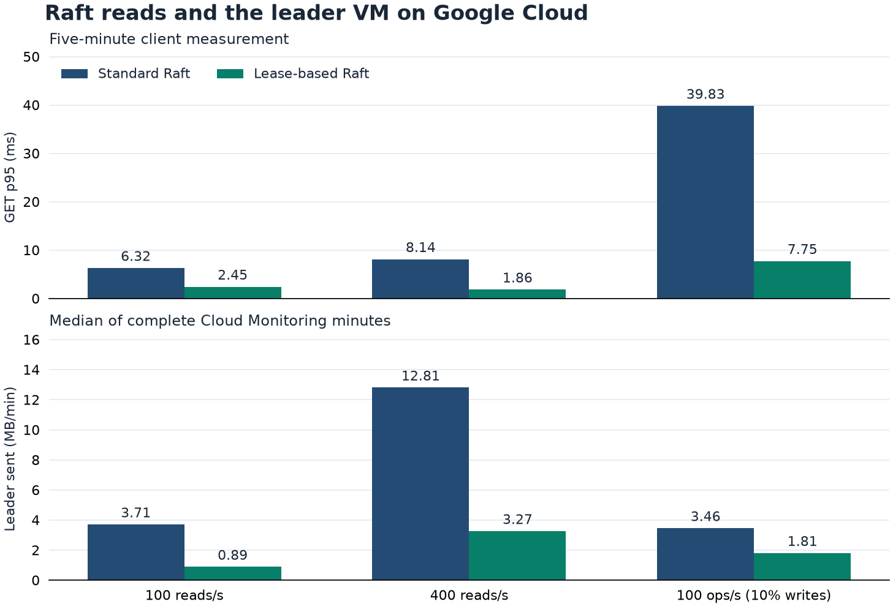

# Sustained Raft benchmark on Google Cloud

All **360,000 scheduled operations** succeeded. In the mixed workload, a leader lease reduced GET p95 by **80.5%**, from 39.83 ms to 7.75 ms. SET p95 stayed near 52 ms in both modes.

## Client results

| Offered workload | GET p95, standard / lease | GET p99, standard / lease | Read-confirmation peer RPC attempts per successful GET, standard / lease |
| --- | ---: | ---: | ---: |
| 100 reads/s | 6.32 / 2.45 ms | 6.74 / 2.65 ms | 4.00 / 0 |
| 400 reads/s | 8.14 / 1.86 ms | 9.71 / 2.06 ms | 3.27 / 0 |
| 100 ops/s, 10% writes | 39.83 / 7.75 ms | 52.46 / 14.23 ms | 3.19 / 0 |

At 10% writes, SET p95 was 51.97 ms with standard Raft and 52.11 ms with the lease. Each SET still required quorum replication. The lease served reads from the leader's applied state while valid, with renewals continuing through background replication. Standard Raft shared some confirmation rounds between overlapping reads.

## Cloud Monitoring results

Each cell is the median of four fully aligned minute samples for the named mode and workload, for 24 minutes total. At 400 reads/s, the lease leader sent **74.5% fewer bytes per minute**, and its median CPU utilization fell from 49.8% to 24.0%.

| Offered workload | Leader sent MB/min, standard / lease | Leader received MB/min, standard / lease | Leader CPU, standard / lease |
| --- | ---: | ---: | ---: |
| 100 reads/s | 3.711 / 0.891 | 3.855 / 1.031 | 21.5% / 8.6% |
| 400 reads/s | 12.811 / 3.267 | 13.465 / 3.911 | 49.8% / 24.0% |
| 100 ops/s, 10% writes | 3.462 / 1.809 | 3.463 / 1.575 | 23.5% / 17.6% |



- [Client outcomes, latencies, and minute histograms (JSON)](gcp-followup-results.json)
- [Client results joined to leader VM samples (CSV)](gcp-followup-aligned-minutes.csv)
- [1,236 anonymized Cloud Monitoring samples from all six VMs (CSV)](gcp-followup-vm-telemetry.csv)

## Setup

On November 26, 2026, five Raft replicas and a dedicated load generator ran on six `e2-standard-2` Ubuntu 24.04 VMs in Iowa (`us-central1`). Replicas 0 and 1 and the driver ran in zone `a`, replicas 2 and 3 in zone `b`, and replica 4 in zone `c`. All gRPC traffic stayed on private addresses. Node 0 led both clusters.

Each mode ran 100 reads/s, then 400 reads/s, then 100 operations/s with 10% writes. Each condition had a 15-second warmup and a five-minute measurement. Standard mode ran first, then lease mode started with its own log on the same VMs. The default profile used 500 ms heartbeats, 3–5 s randomized election timeouts, and a 2 s lease where applicable. [Source commit `9151350`](https://github.com/Samyzx/raft-consensus/tree/91513507bde6acd57c41860f96db9afc0e31ddca)

## Measurement

The driver timed each gRPC call to the leader with a monotonic clock, starting after the request scheduler admitted the call. The report computes p95 and p99 by nearest rank over successful calls. Successful `GET` responses were checked against a known committed value. The JSON retains outcomes, request counts, and per-minute latency histograms for each operation. The driver assigns requests to UTC minutes by their scheduled dispatch time. [Benchmark source](../raftkv/remote_benchmark.py)

For the infrastructure comparison, each workload contributes only the UTC minutes fully inside its five-minute measurement window. The join matches the leader's Compute Engine time series to each application minute by its end timestamp. Network bytes are minute totals in decimal MB. CPU is the hypervisor's utilization sample at the minute end. The joined data also includes scheduler wait, disk write operations, and average I/O latency. VM network counters measure all traffic at the interface, including client calls, Raft peer traffic, and background traffic. The application separately counts peer RPC attempts dedicated to read confirmation. [Compute Engine metrics](https://docs.cloud.google.com/monitoring/api/metrics_gcp_c)

Each mode and workload has one five-minute trial, with a fixed mode order and the driver in the leader's zone. The fixed offered rates characterize latency and resource use at those loads. The earlier benchmark covers process crashes and quorum loss. [Original cloud benchmark](gcp-benchmark.md#failure-and-recovery)

## Reproduce

Deploy the same placement in both modes. From the driver, run the commands below in order for a healthy standard cluster, then for a healthy lease cluster. Use the cluster configuration with the replicas' private addresses. [Remote benchmark instructions](../README.md#benchmark-from-a-separate-vm)

```bash
python -m raftkv.remote_benchmark --cluster cluster.vm.json load --rps 100 --write-percent 0 --warmup 15 --seconds 300 --minute-histograms
python -m raftkv.remote_benchmark --cluster cluster.vm.json load --rps 400 --write-percent 0 --warmup 15 --seconds 300 --minute-histograms
python -m raftkv.remote_benchmark --cluster cluster.vm.json load --rps 100 --write-percent 10 --warmup 15 --seconds 300 --minute-histograms
```

Query Cloud Monitoring for the corresponding absolute UTC interval and filter by the leader's numeric instance ID. For network traffic, retain the minute sums. Use the native sample for CPU. [Cloud Monitoring time-series API](https://docs.cloud.google.com/monitoring/api/ref_v3/rest/v3/projects.timeSeries/list)
